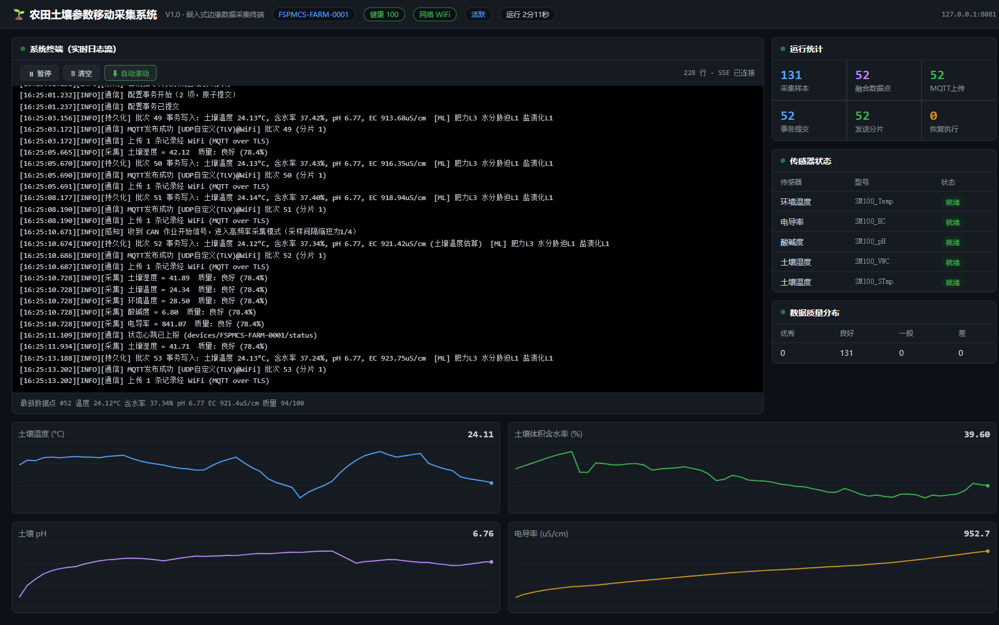
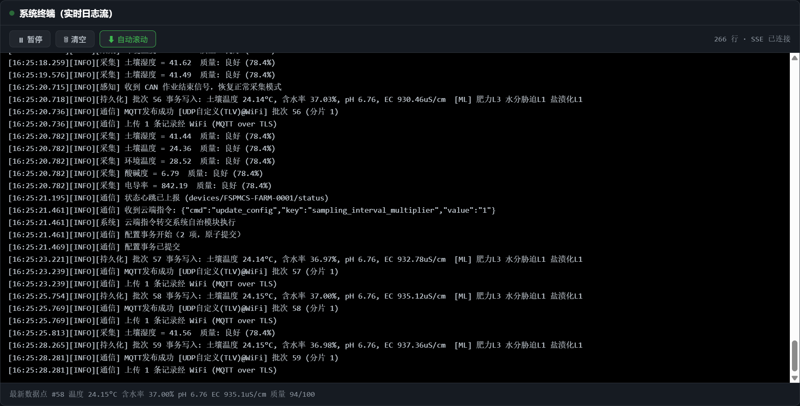
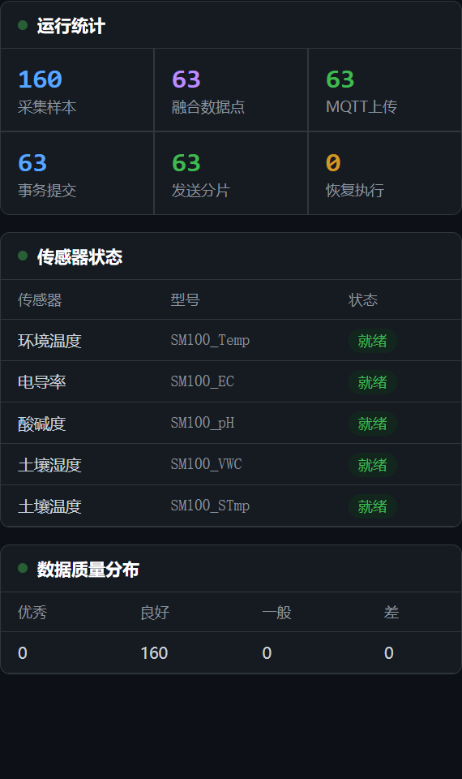
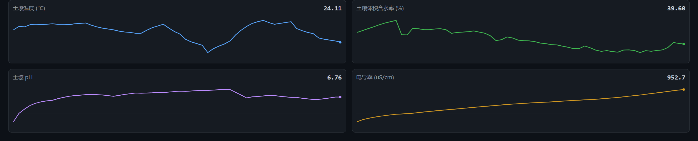

# 农田土壤参数移动采集系统（FSPMCS）

**Farmland Soil Parameter Mobile Collection System**

面向精准农业的嵌入式边缘数据采集与处理终端。系统集成多参数土壤传感器，实现温度、湿度、
pH、电导率等参数的实时同步采集；通过边缘计算完成多传感器融合、自适应校准与轻量级智能分析，
输出高质量结构化数据；具备自主运行、动态调度、异常检测与自恢复能力，支持农机、巡检机器人
等移动载具部署，并提供开箱即用的 Web 实时监控面板（内嵌终端）。

> 纯 C++17 与标准库实现，**零第三方依赖**，单二进制交付，Windows / Linux 双平台编译运行。

---

## 界面预览

**Web 实时监控面板**（仪表盘 + 内嵌终端 + 趋势图表）：



<details>
<summary>更多界面截图</summary>

内嵌终端 —— SSE 实时推送系统全部日志流：



运行统计 / 传感器状态 / 数据质量：



土壤参数实时趋势曲线：



</details>

## 功能特性

**感知与信号调理**
- 多总线传感器接入：I2C / SPI / UART / ADC（含 SDI-12、RS-485 扩展位）
- 上电自检：厂商 ID 校验、电导率短路校准、pH 电极阻抗测量
- 动态采样调度：优先级任务队列，CAN 总线作业信号触发高频模式（采样间隔缩至 1/4）
- 位置感知触发：载具移动时按距离采样（每 2 米），静止 10 分钟进入低功耗监测
- 三级信号调理流水线：滑动平均滤波 → Tukey 围栏异常值剔除 → 传感器特异性温度补偿
- 实时质量控制：二次多项式校准、pH 凌晨零点校准、加权置信度评分（0~100）

**智能融合与边缘分析**
- 8 状态扩展卡尔曼滤波（EKF）动态融合，过程噪声随载具振动自适应调整
- 递推最小二乘（RLS）在线校准，补偿传感器慢变漂移
- GPS PPS 高精度时钟 + INS 惯性推算，拉格朗日三点插值时空对齐
- 轻量级 ML 分析：肥力等级 / 水分胁迫 / 盐渍化风险分级与参数异常判定
- 传感器故障时基于关联模型的缺失参数估算补全（降级运行）

**数据组织与持久化**
- 嵌入式文件数据库（原子替换落盘），事务写入支持回滚
- 四表结构：`config` / `sensor_raw` / `processed_data` / `system_events`
- 差分 + 变长编码归档压缩、四分区存储管理、LRU 数据老化
- 三维索引：时间索引 / Geohash 空间索引 / 特征直方图索引

**通信与协同**
- 多网络链路质量评分与智能切换（信号 30% + 成功率 40% + 延迟 20% + 能耗 10%）
- 自适应协议：WiFi → UDP/TLV，蜂窝 → MQTT over TLS，LPWAN → CoAP/CBOR
- 三级 QoS、滑动窗口拥塞控制（加性增/乘性减）、令牌桶流量控制、CRC32 智能分片
- 安全通信：TLS 1.3 双向证书认证、应用层加密密钥 24 小时轮换
- 远程管理：原子配置事务、差分 OTA 固件升级

**系统自治理与调度**
- 四维资源监控（计算/内存/存储/网络）三级阈值告警，5 分钟滑动窗口性能分析
- 归一化马氏距离异常评分（>2 可能异常 / >3 很可能 / >5 严重），分级自动恢复
- 四级任务调度（优先级老化 + 资源预留）、软件看门狗线程心跳监测
- 五级设备状态功耗管理、电池健康监测与维护预警

**Web 监控面板**
- 内嵌终端：SSE 实时推送全系统日志流，支持暂停/清空/自动滚动
- 实时仪表盘：运行统计、传感器状态、数据质量分布、四路参数趋势曲线
- RESTful API + SSE，无前端框架依赖

## 系统架构

```
┌────────────────────────────────────────────────────────────────┐
│                     系统编排器（6 核心线程）                      │
│   主监控 / 数据采集 / 数据处理 / 存储转发 / 网络监听 / 定时任务     │
├──────────┬──────────┬──────────┬──────────┬────────────────────┤
│ ①感知与   │ ②智能融合 │ ③数据组织 │ ④通信与   │ ⑤系统自治理         │
│  信号调理 │  与边缘   │  与持久化 │  协同     │  与调度            │
├──────────┴──────────┼──────────┴──────────┴────────────────────┤
│  Web 监控面板        │   HTTP + SSE：仪表盘/内嵌终端/趋势图表/API │
├─────────────────────┴──────────────────────────────────────────┤
│       硬件抽象层（I2C / SPI / UART / ADC / GPS / CAN / IMU）      │
│    SimulatedHardware（开发仿真）⇄ NativeHardware（目标机驱动）     │
└────────────────────────────────────────────────────────────────┘
```

数据流水线：

```
传感器 → 信号调理 → [条件数据队列] → 时空对齐 + EKF融合 + 边缘分析
      → [融合队列] → 事务写入数据库 → MQTT 上传 → 云端确认 → 同步状态更新
```

## 快速开始

### 环境要求

| 平台 | 工具链 |
|------|--------|
| Windows | MinGW-w64 (GCC 9+) 或 MSVC 2019+ |
| Linux | GCC 9+ / Clang 10+（目标机：ARM Cortex-A53 + Linux 5.10） |

### 构建运行

```bash
# 方式一：CMake
cmake -B build -DCMAKE_BUILD_TYPE=Release
cmake --build build -j

# 方式二：直接编译
g++ -std=c++17 -O2 -Iinclude src/*.cpp -o soil_collection_system   # Linux
g++ -std=c++17 -O2 -Iinclude -static src/*.cpp -lws2_32 -o scs.exe # Windows(MinGW)
```

```bash
# 标准监测场景（默认运行 60 秒，Web 面板 http://localhost:8080）
./soil_collection_system

# 载具移动场景：距离触发采集模式
./soil_collection_system --moving

# 传感器故障注入场景：观察异常检测与自动恢复
./soil_collection_system --fault
```

### 命令行参数

| 参数 | 说明 |
|------|------|
| `--duration <秒>` | 运行时长（默认 60，生产环境为常驻运行） |
| `--moving` | 仿真载具移动，启用距离触发采集模式 |
| `--fault` | 注入电导率传感器故障，演示自恢复流程 |
| `--quiet` | 控制台静默（日志仍实时推送至 Web 终端） |
| `--web <端口>` | Web 面板端口（默认 8080） |
| `--no-web` | 禁用 Web 面板 |

运行产物：`data/soil_database.json`（数据库）、`data/archive/`（归档块）、`logs/system.log`（日志）。

## Web 监控面板

启动后浏览器访问 `http://localhost:8080`：

| 路由 | 说明 |
|------|------|
| `GET /` | 监控面板页面 |
| `GET /api/status` | 系统状态快照（模块统计/传感器状态/最新数据点） |
| `GET /api/data?count=N` | 近期融合数据时序（图表数据源） |
| `GET /api/logs?count=N` | 最近日志条目 |
| `GET /api/stream` | SSE 实时日志流（内嵌终端数据源） |

## 配置说明

传感器参数通过 `config/sensors.json` 配置（型号、总线地址、校准系数、采样间隔、优先级），
支持远程配置事务热更新。示例：

```json
{"model": "Capacitive-Soil-Moisture", "address": 19, "sample_rate_hz": 200,
 "calibration_coeffs": [0.0, 1.0, 0.0], "interval_ms": 5000, "priority": 1}
```

## 项目结构

```
soil_collection_system/
├── CMakeLists.txt
├── config/sensors.json            # 传感器配置数据库
├── docs/images/                   # 界面截图
├── include/
│   ├── common.h                   # 公共类型与工具
│   ├── data_queue.h               # 线程安全队列
│   ├── logger.h                   # 日志子系统
│   ├── hardware_abstraction.h     # 硬件抽象层
│   ├── sensing_module.h           # ①感知与信号调理
│   ├── fusion_module.h            # ②智能融合与边缘分析
│   ├── storage_module.h           # ③数据组织与持久化
│   ├── comm_module.h              # ④通信与协同
│   ├── autonomy_module.h          # ⑤系统自治理与调度
│   ├── system_orchestrator.h      # 系统编排器
│   ├── web_server.h               # Web 服务器
│   └── web_assets.h               # 面板页面资源（内嵌）
└── src/                           # 对应实现
```

## 嵌入式目标机移植

开发平台使用 `SimulatedHardware` 仿真层；部署到 i.MX8M Mini 等目标机时，
按相同接口实现 `NativeHardware` 即可，上层模块无需改动：

| 仿真接口 | 目标机实现 |
|----------|-----------|
| `i2c_read/write` | Linux i2c-dev（ioctl I2C_RDWR） |
| `spi_transfer` | spidev |
| `uart_send/receive` | termios（SDI-12 / RS-485 / Modbus 帧收发） |
| `adc_read` | 处理器内置 ADC 或外置 ADS1256 |
| `get_gps_data` | UART + NMEA-0183 解析 + PPS 秒脉冲 |
| `receive_can_signal` | SocketCAN |
| 文件数据库 | 可等价替换为 SQLite3 |
| MQTT / TLS | 可替换为 Eclipse Paho / mbedTLS |

## 路线图

- [ ] 原生硬件抽象层实现（i2c-dev / spidev / SocketCAN）
- [ ] SQLite3 持久化引擎
- [ ] mbedTLS 真实 AES-GCM 与证书管理
- [ ] OTA 差分包签名校验
- [ ] 单元测试与 CI
- [ ] 英文文档

## 许可证

本项目基于 [MIT License](LICENSE) 开源。
